# Ten Orders a Day: Building a Leakage-Safe Late-Delivery Risk Policy on Amazon SageMaker

*Turn 100,000 Brazilian e-commerce orders into a daily top-10 investigation list, compare it honestly against simple business rules, and find the one leak that almost slipped through.*

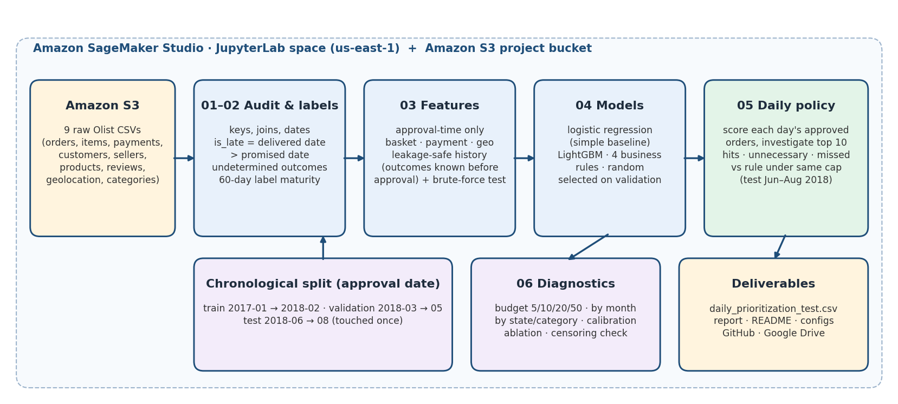
*Architecture: raw Olist CSVs in Amazon S3 → SageMaker Studio JupyterLab notebooks 01–02 (audit and labels) → 03 (approval-time features) → 04 (models, selected on validation) → 05 (daily top-10 policy on the held-out test period) → 06 (diagnostics) → report, daily list and code in GitHub, Google Drive and S3*

Have you ever been handed a model with a great ROC-AUC, asked "so which orders should my team call today?", and realised that the metric doesn't answer that question at all?

A logistics team doesn't act on a probability curve. It acts on a short list. In this project the business rule was blunt: **the team can investigate at most 10 newly approved orders per day.** Anything that isn't in today's top 10 doesn't get looked at. In this blog post, I'll guide you through turning that requirement into a machine learning task that respects it end to end: what we predict, *when* we're allowed to predict it, which information is fair game at that moment, and how we score the result the same way the team would experience it.

We'll use the public Olist Brazilian e-commerce dataset (99,441 orders, 2016–2018), Amazon S3 for the raw data, Amazon SageMaker Studio (JupyterLab space) for the notebooks, and plain scikit-learn and LightGBM for the models. Then we'll compare the learned models against four non-ML business rules and a random baseline, all under the same 10-per-day budget. Finally, I'll show the audit that found a subtle leak in my own history features, how I fixed it, and how much the numbers moved (spoiler: by one order).

By the end of this guide, you'll have:

1. A reproducible project layout: an importable Python package (`src/olist_risk`), seven numbered notebooks, and a `run_all.py` that executes them in order with papermill.
2. A data audit of the nine Olist tables, including timestamp inconsistencies you have to decide about before modelling.
3. A precise label (`is_late` on calendar dates) and a chronological train / validation / test design with a 60-day label-maturity rule.
4. Approval-time features, including seller, customer and route history that only uses outcomes observed *before* the order was approved, plus a brute-force unit test that proves it.
5. A logistic-regression baseline and a LightGBM model, selected on validation by the business metric (late orders caught in the daily top 10), not by AUC.
6. A daily top-10 policy evaluated on a held-out quarter against business rules, a random baseline and a perfect-foresight oracle, with a day-level bootstrap confidence interval.
7. Sensitivity checks: different budgets, month by month, feature ablations, censoring at the data export, and model drivers.
8. The daily investigation list for the test period (869 rows, traceable to `order_id`).

## Understanding the Building Blocks

**What is "delivery risk" here?**

- An order is **late** if the calendar date it reached the customer is after the calendar date Olist promised. Olist shows customers a date, not a time, so an order delivered at 18:00 on the promised day is on time for the customer.
- An order with no customer-delivery date (canceled, unavailable, still in transit at export) has an **undetermined** outcome. It's never used for training, but it still sits in the daily pool, because on the day of approval nobody knows it will be canceled. If the policy picks it, that investigation is reported separately, not silently dropped.

**What is a "daily top-k policy"?**

- Every calendar day, score all orders approved that day, sort by risk, and investigate the top 10 (all of them if fewer than 10 arrived).
- The score only matters through the ranking *within a day*. A model with a slightly worse global AUC can be better at the top of each day, and the reverse.

**What is leakage in this setting?**

- Leakage is any feature that uses information the team wouldn't have at approval time. The obvious ones (delivery dates, review scores, the final status) are easy to exclude. The subtle ones live inside history aggregates such as "share of this seller's past orders that were late": *past* has to mean "delivered before this order was approved", not "placed before it".

**What is Amazon SageMaker Studio?**

- A browser-based ML workspace. I used a SageMaker AI domain with one user profile and a JupyterLab space (ml.m5.xlarge), with a lifecycle configuration that clones the code and installs pinned versions.

## How the Design Works (and What It Deliberately Doesn't Do)

The pipeline is a straight line of seven notebooks. Each one reads the previous step's outputs from `data/processed` or `outputs/` and writes its own tables and figures, so any step can be re-run and inspected on its own.

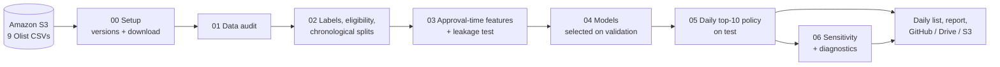

What it deliberately doesn't do:

- **No random train/test split.** Splits are by approval date: train 2017-01-01 to 2018-02-28, validation March to May 2018, test June to August 2018. Late rates drift a lot over time (10.3% in validation, 3.6% in test), and a random split would hide that.
- **No test-period tuning.** Every choice (model family, hyperparameters, feature set, the reference rule) is made on validation and frozen before the test notebook runs. That includes not swapping in a rule that turned out to win on test.
- **No SMOTE or synthetic resampling.** The goal is ranking within a day, and resampling doesn't change a ranking-based metric in a helpful way. I tried `class_weight="balanced"` in the grid and let validation decide.
- **No deployment.** This is a decision-support study, not an endpoint.

## Prerequisites

Here's what I used, and what you need to follow along:

- An AWS account with an S3 bucket for the raw data (mine is `ml-project2-olist-044450716277`, prefix `ml-project2-v2/data/raw/`).
- A SageMaker AI domain in us-east-1 (`machinelearningproj2ajay-ecommerce`) with a JupyterLab space. Any Python 3.10–3.13 environment also works; the final re-run below was done locally.
- The nine Olist CSVs from Kaggle ("Brazilian E-Commerce Public Dataset by Olist").
- Pinned libraries: numpy 2.2.6, pandas 2.2.3, scikit-learn 1.6.1, lightgbm 4.6.0, matplotlib 3.10.0, papermill.
- The code: https://github.com/Ajayuppu/E-Commerce-Delivery-Risk-Management

## Overview of Steps

1. Set up the environment and pull the raw data from S3
2. Audit the raw tables
3. Define the label and the chronological splits
4. Build approval-time features without leakage
5. Train and select the models on validation
6. Evaluate the daily top-10 policy on the test quarter
7. Stress-test the result
8. Review the evidence and the limits

Now, let's get started!

## Step 1: Set Up the Environment and Pull the Raw Data

### 1a. Create the environment

In SageMaker Studio, open the JupyterLab space, start a terminal and run the bootstrap script. It creates a `.venv`, installs `requirements.txt`, registers a kernel called **Python (ml-project2-v2)** and downloads the CSVs from S3:

```bash
git clone https://github.com/Ajayuppu/E-Commerce-Delivery-Risk-Management.git ~/ml-project2-v2
bash ~/ml-project2-v2/aws/studio_bootstrap.sh --no-run
```

Anywhere else:

```bash
python -m venv .venv && source .venv/bin/activate
pip install -r requirements.txt
python -m ipykernel install --user --name mlproj2 --display-name "Python (ml-project2-v2)"
```

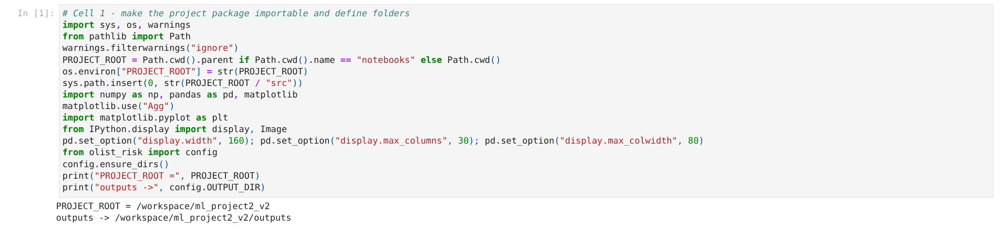
*Notebook 00, cell 1: the project package becomes importable and the output folders are created (final re-run)*

### 1b. Download the raw CSVs only if they're missing

```python
S3_BUCKET = os.environ.get("PROJECT_BUCKET", "ml-project2-olist-044450716277")
S3_RAW_PREFIX = os.environ.get("RAW_PREFIX", "ml-project2-v2/data/raw/")
missing = [f for f in config.RAW_FILES.values() if not (config.RAW_DIR / f).exists()]
```

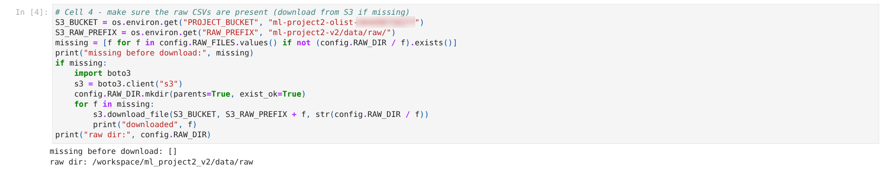
*Notebook 00, cell 4: the raw-data check; nothing is missing, so nothing is downloaded*

**Settings and why:**

- **Pinned versions** in `requirements.txt`: LightGBM and scikit-learn defaults change between releases, and the comparison is sensitive to a handful of orders.
- **Environment variables for the bucket and prefix**, so the same notebook runs in Studio and locally.

**Expected vs. observed:** expected the nine files and an empty `missing` list. Observed exactly that.

## Step 2: Audit the Raw Tables

Before writing any label, I wanted to know how messy the timestamps were. Notebook 01 checks table sizes, key relationships, order statuses and, most importantly, the order lifecycle dates.

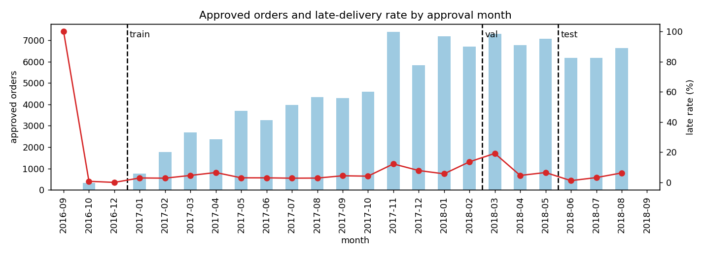
*Monthly approved orders and late rate: volume grows steadily, while the monthly late rate swings between about 1% (June 2018) and 19% (March 2018)*

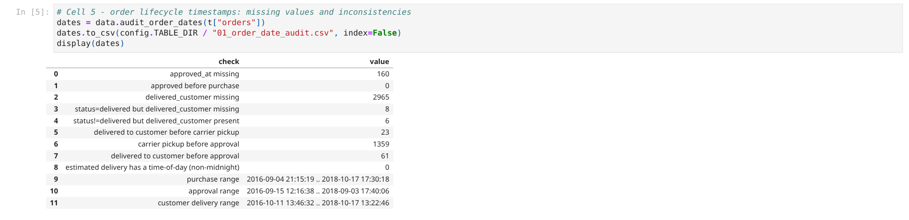
*Notebook 01, cell 5: lifecycle timestamp audit, including the 61 orders delivered to the customer before their own approval timestamp*

**Expected vs. observed:**

- 160 orders were never approved (no decision time, so they're out).
- 2,965 orders have no customer-delivery date, which is why the undetermined outcome exists.
- 23 orders were "delivered to the customer" before the carrier picked them up.
- **61 orders were delivered to the customer before their own approval timestamp.** I first treated this as harmless noise. It wasn't (see Step 4).

### Data audit troubleshooting notes

- *"My late rate is about 8%, the report says about 6.8%."* You're comparing timestamps. Compare calendar dates: 1,292 orders arrived on the promised day and are on time for the customer.
- *"Order counts don't match between tables."* Orders can have several items and sellers. Aggregate items to order level first (number of sellers, total price, freight ratio, main category).

## Step 3: Define the Label and the Chronological Splits

### 3a. The label on calendar dates

```python
is_late = order_delivered_customer_date.dt.normalize() > order_estimated_delivery_date
```

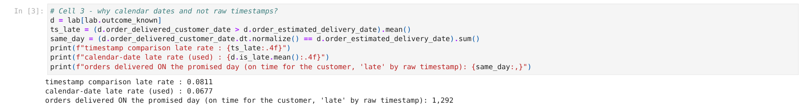
*Notebook 02, cell 3: timestamp vs. calendar-date late rate (8.1% vs. 6.8%)*

### 3b. Splits and label maturity

| Split | Approval dates | Orders in daily pool | Late (labelled) | Late rate |
|---|---|---|---|---|
| Train | 2017-01-05 → 2018-02-28 | 58,866 | 3,740 | 6.6% |
| Validation | 2018-03-01 → 2018-05-31 | 21,132 | 2,120 | 10.3% |
| Test | 2018-06-01 → 2018-08-29 | 18,960 | 672 | 3.6% |

**Settings and why:**

- **60-day label maturity.** A training example has to be approved at least 60 days before the cutoff *and* have its outcome observed before it. Without this, the last weeks before the cutoff only keep the orders that were delivered quickly, which are mostly on time, and the model learns a rosier world. This leaves 43,276 rows to fit the selection models and 64,109 rows (train + validation) for the final refit.
- **Undetermined orders stay in the pool.** In the test quarter, 315 of 18,960 orders never got a delivery date.

## Step 4: Build Approval-Time Features Without Leakage

### 4a. What the model is allowed to see

Every feature is documented with *where it comes from* and *when it becomes known*: promised days, approval delay, basket size, weight and volume, freight ratio, customer and seller state, distance, category, and history features for the seller, the customer and the route.

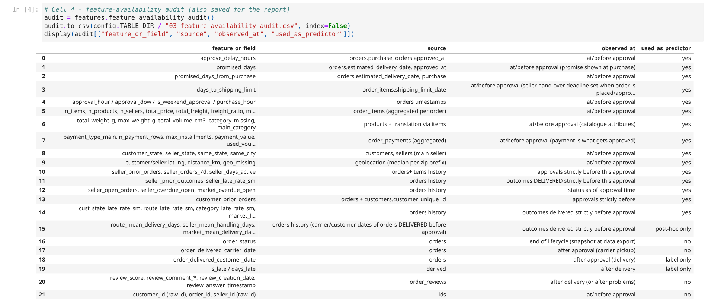
*Notebook 03, cell 4: feature-availability audit; each row says when the field is observed and whether it's used as a predictor*

### 4b. History features: "before" has to mean before

The history features are cumulative counts with a strict "before" condition: when queries and events have the same timestamp, the query is sorted first, so an order can never count itself. An outcome counts as history from the moment it was *known*.

That's where the 61 orders bit me. My first version defined "known" as the customer-delivery timestamp. For an order delivered *before* its own approval timestamp, that means its own outcome was already "in the past" when it was scored. It's a tiny leak, but it's a leak. The fix is one line:

```python
def outcome_event_time(df):
    ok, a = df["outcome_known_at"], df["order_approved_at"]
    return ok.where(ok.isna() | a.isna() | (ok > a), a)   # max(delivery, approval)
```

An outcome becomes usable history only from max(delivery, approval).

### 4c. Prove it with a brute-force test

The vectorised features are recomputed the slow way, by filtering the full table for each sampled order. The sample is 300 random orders **plus all 61 edge cases**, and the notebook asserts that every value matches and that no order ever sees its own outcome:

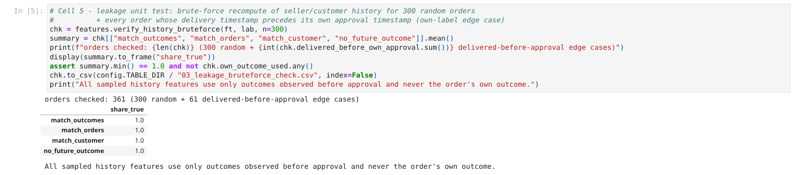
*Notebook 03, cell 5: brute-force leakage test on 361 orders (300 random + 61 delivered-before-approval); all checks are 1.0*

**Expected vs. observed:** expected 100% matches. In the original run the random sample happened to miss all 61 edge cases, which is exactly why the leak survived. After the fix and with the edge cases forced in, all 361 orders matched and the assertion passed.

### Feature troubleshooting notes

- *"My history features look too good."* Check the time key, not just the join key. Use the outcome-known time (with the approval floor), not the purchase time.
- *"The brute-force test passes but I still don't trust it."* Force known edge cases into the sample instead of relying on a random draw.

## Step 5: Train and Select the Models on Validation

### 5a. Two model families, small grids

- **Logistic regression**: one-hot categoricals, log-transformed counts, standardised numerics; C in {0.01, 0.1, 1.0}, with and without balanced class weights; `max_iter=20000`, `tol=1e-8` so the solver fully converges.
- **LightGBM**: shallow trees (7 or 15 leaves), 200 or 500 trees, `min_child_samples` 100 or 400, learning rate 0.03, `deterministic=True`.
- Two feature sets: all features, and all features minus the market-level ones.

### 5b. Select by the business metric

The selection criterion is the number of late orders caught by the daily top 10 on validation, with PR-AUC as tie-breaker:

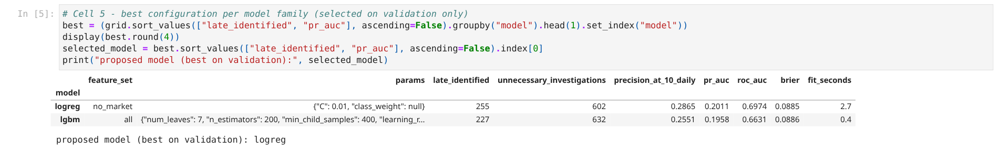
*Notebook 04, cell 5: best configuration per family on validation; logistic regression (C = 0.01, no market features) catches 255 late orders vs. 227 for LightGBM*

| Method (validation, 10/day) | Late identified | PR-AUC |
|---|---|---|
| Logistic regression (C = 0.01, no_market) | 255 | 0.201 |
| LightGBM (7 leaves, 200 trees, mcs 400) | 227 | 0.196 |
| Rule: longest distance (best rule) | 202 | 0.167 |
| Random (mean of 200 draws) | 87.8 | 0.103 |
| Rule: shortest promised window | 46 | 0.099 |

**Settings and why:** the simpler model won on validation, so it's the proposed model. The longest-distance rule was the best rule on validation, so it becomes the reference rule for the test comparison. Both choices are frozen here. The selected model is then refit on train + validation (64,109 mature rows) before scoring the test quarter.

## Step 6: Evaluate the Daily Top-10 Policy on the Test Quarter

### 6a. Operational results

The test quarter has 88 days, 18,960 approved orders and 672 late ones. Each method gets 869 investigations (two days had fewer than 10 orders).

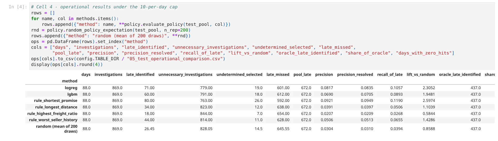
*Notebook 05, cell 4: operational comparison under the 10-per-day cap on the test quarter*

| Method (test, 10/day) | Late identified | Unnecessary | Undetermined selected | Late missed | Precision |
|---|---|---|---|---|---|
| **Logistic regression (proposed)** | **71** | 779 | 19 | 601 | 8.2% |
| LightGBM | 60 | 791 | 18 | 612 | 6.9% |
| Rule: longest distance (reference) | 34 | 823 | 12 | 638 | 3.9% |
| Rule: shortest promised window | 80 | 763 | 26 | 592 | 9.2% |
| Random (mean of 200 draws) | 26.45 | 828.05 | 14.5 | 645.55 | 3.0% |
| Perfect foresight (oracle) | 437 | – | – | – | – |

The proposed model finds **2.31 times as many late orders as random** and roughly twice as many as the reference rule.

### 6b. Is the gain real? A paired, day-level bootstrap

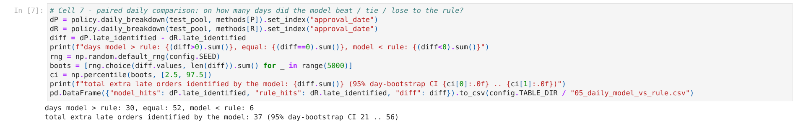
*Notebook 05, cell 7: the model beats the rule on 30 days, ties on 52 and loses on 6; +37 late orders (95% day-bootstrap CI 21 to 56)*

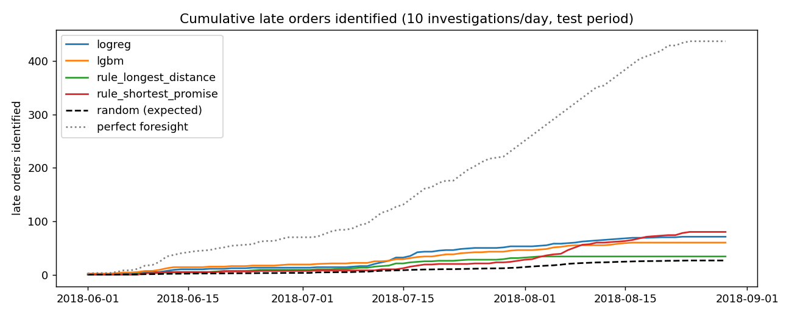
*Cumulative late orders identified across the test quarter: the gap opens in mid-July and keeps widening*

### 6c. The awkward result I kept in

The shortest-promise rule, which was the *worst* method on validation (46 hits), is the best on test (80 hits). I didn't swap it in after the fact, because that would be choosing on the test set. The honest reading is drift: the late rate fell from 10.3% to 3.6%, and in a calm quarter the orders with very short promised windows are the ones that still go wrong. It's a reason to monitor rules and model side by side, not a reason to rewrite the conclusion.

### 6d. The list the team actually gets

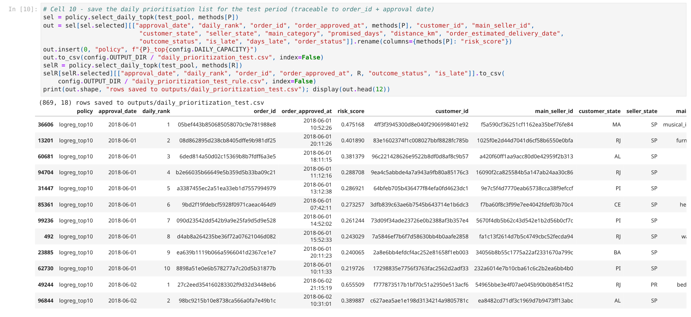
*Notebook 05, cell 10: the daily prioritisation list (869 rows), with rank, order_id, risk score, states, category, promised days and distance*

## Step 7: Stress-Test the Result

### 7a. Different budgets

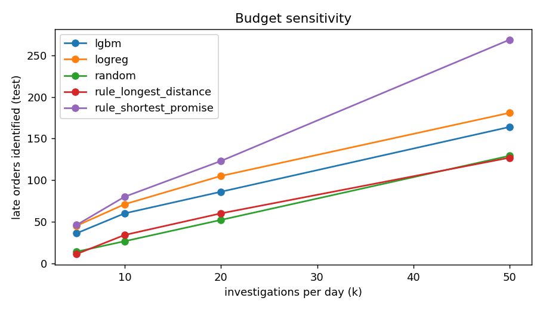
*Late orders identified at 5, 10, 20 and 50 investigations per day*

With 5 per day the model catches 45, with 10 it catches 71, with 20 it catches 105 and with 50 it catches 181. Precision is highest at the top of each day: about 13% at daily ranks 1–2, falling to 3–9% at ranks 6–10. Doubling the team doesn't double the catch.

### 7b. Month by month

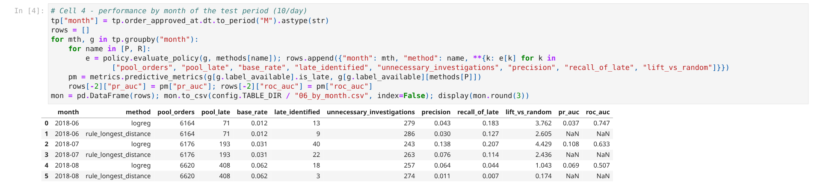
*Notebook 06, cell 4: test performance per month; strong in June and July, about random in August*

June and July show a lift of 3.8 and 4.4 over random. In August the lift drops to 1.04, while the late rate doubles to 6.2%. Whatever drove August's delays wasn't in the training history.

### 7c. What drives the score

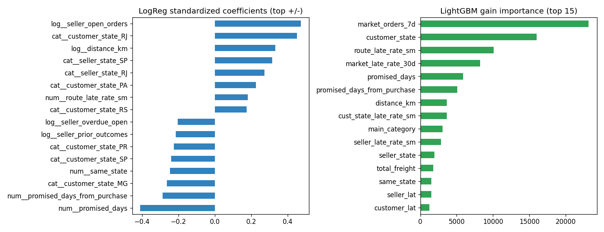
*Model drivers: logistic-regression coefficients and LightGBM gain importance*

The strongest signals are the seller's currently open orders, distance, a Rio de Janeiro destination and a São Paulo seller (pushing risk up), and long promised windows, same-state shipping and an experienced seller (pushing risk down). LightGBM leans heavily on market-level features (orders in the last 7 days, the 30-day market late rate), which the selected logistic regression doesn't use. In the ablation, removing those market-level features helps slightly (71 vs. 66), and history features alone catch only 31.

### 7d. Censoring at the data export

The dataset ends on 2018-10-17. Some test orders were still open (shipped, invoiced, processing) and already past their promised date at that point. They're almost certainly late, but the main analysis treats them as undetermined. As a sensitivity check, I counted those 191 orders as delivery problems:

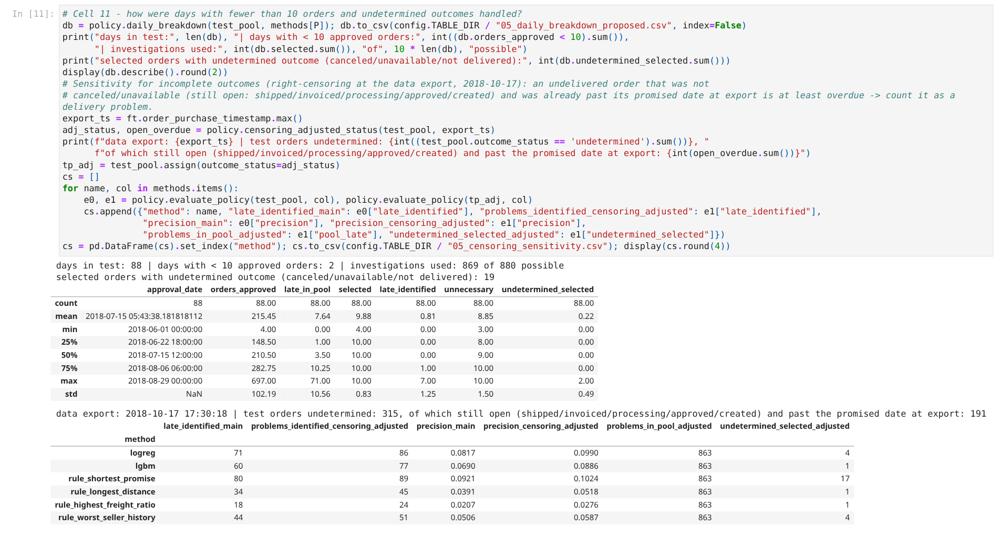
*Notebook 05, cell 11: daily breakdown and the censoring sensitivity; counting the 191 open, overdue orders as problems leaves the ranking unchanged*

Logistic regression goes from 71 to 86, the shortest-promise rule from 80 to 89, LightGBM from 60 to 77 and longest distance from 34 to 45. The ranking is unchanged.

## Step 8: Review the Evidence and the Limits

### 8a. What changed after the audit

I ran the whole project in SageMaker Studio first. A skeptical re-check then found the 61-order leak described in Step 4. After the fix, I re-ran the full pipeline locally with the same pinned versions. Every number in this post, and every screenshot, comes from that final run (so the paths in the screenshots are local, not Studio):

| Metric | Before fix (Studio) | After fix (final) |
|---|---|---|
| Logistic regression, test, late identified | 70 | 71 |
| LightGBM, test, late identified | 58 | 60 |
| Logistic regression, validation | 256 | 255 |
| Model vs. rule (95% CI) | +36 (20–55) | +37 (21–56) |
| Rules, random, oracle | unchanged | unchanged |

The leak was real but small, and fixing it slightly *improved* the test result. The bigger lesson is about the test: a random sample can miss exactly the rows that break your assumption.

### 8b. What worked

- The business metric drove every choice, from model selection to the final table.
- Chronological splits with label maturity made the drift visible instead of hiding it.
- The brute-force leakage test, once it included the edge cases, caught a real bug.
- Two full runs on the same machine produced byte-identical result tables.

### 8c. Limits to keep in mind

- Precision is still low (8.2%). About 9 in 10 investigations (779 of 869) are on orders that arrive on time.
- August shows the model can go flat when the cause of delays changes.
- A simple rule beat the model on test. A production version should track at least one rule as a live baseline.
- Olist's timestamps are noisy (61 orders delivered before approval, 23 before carrier pickup).

## Troubleshooting

**Symptom:** `ModuleNotFoundError: olist_risk` in a notebook.
**Likely cause:** the kernel isn't the project kernel, or the notebook isn't started from `notebooks/`.
**Fix:** select **Python (ml-project2-v2)** at the top right; cell 1 of notebook 00 adds `src/` to the path.

**Symptom:** `run_all.py` fails with "No such kernel".
**Likely cause:** the kernel is registered under another name.
**Fix:** `NB_KERNEL=python3 python run_all.py`.

**Symptom:** the brute-force leakage assertion fails.
**Likely cause:** a history feature uses the delivery time without the approval floor, or ties are sorted the wrong way.
**Fix:** use `outcome_event_time()` and keep queries before events on equal timestamps.

**Symptom:** a non-selected logistic-regression configuration differs by one or two validation hits on another machine.
**Likely cause:** BLAS/CPU differences in weakly regularised fits.
**Fix:** expected. The selected configuration and all reported numbers were stable in the cross-machine check.

**Symptom:** S3 download fails in Studio with AccessDenied.
**Likely cause:** the Studio execution role can't read the bucket.
**Fix:** give the role `s3:GetObject` and `s3:ListBucket` on the project bucket and prefix.

## Best Practices

- **Write down the decision time first.** Every feature and label decision follows from "what do we know at approval?".
- **Score the policy, not just the model.** Ranking within a day under a fixed budget is a different problem from global classification.
- **Freeze choices on validation**, and report the inconvenient test results anyway.
- **Test leakage by brute force, and seed the test with known edge cases.**
- **Keep a random baseline and an oracle** in every table, so "71" has a scale (26 by chance, 437 at best).
- **Report undetermined outcomes and censoring explicitly** instead of dropping them.

## Conclusion

We took a one-line business requirement, "investigate at most 10 orders a day", and built a pipeline that respects it at every step: an approval-time decision point, calendar-date labels, chronological splits with label maturity, history features that provably only use the past, and an evaluation that counts what the team would actually experience.

On the held-out quarter, the proposed logistic regression caught 71 late orders with 869 investigations, versus 34 for the best validation rule and 26 by chance, a gain of +37 with a 95% day-bootstrap interval of 21 to 56. It wasn't perfect: a simple rule did better in a calm, drifted quarter, and August went flat. But it's a defensible, reproducible starting point, and the audit showed that a single forced edge case in a unit test is worth more than a good-looking AUC.

All code, notebooks, the report and the daily list are on GitHub: https://github.com/Ajayuppu/E-Commerce-Delivery-Risk-Management

---

**Ajay Uppu** is an **AWS Community Builder and AI/ML & Cloud Engineer** focused on turning advances in artificial intelligence into practical, scalable applications. With four years of experience across cloud and AI engineering, he combines cloud infrastructure expertise with hands-on work in generative AI and natural language processing.

His experience includes building retrieval-augmented generation (RAG) applications, fine-tuning language models, and developing cloud-based AI solutions using AWS, Python, PyTorch, and Hugging Face. Through his writing, Ajay shares technical insights and lessons from building with these technologies, helping readers connect concepts with real-world implementation.

For more updates and questions, you can connect with me through my social media channels [LinkedIn](https://www.linkedin.com/in/ajayuppu/), [X (Twitter)](https://twitter.com/AjayUppu1) to exchange ideas, ask questions, or explore collaborations.
